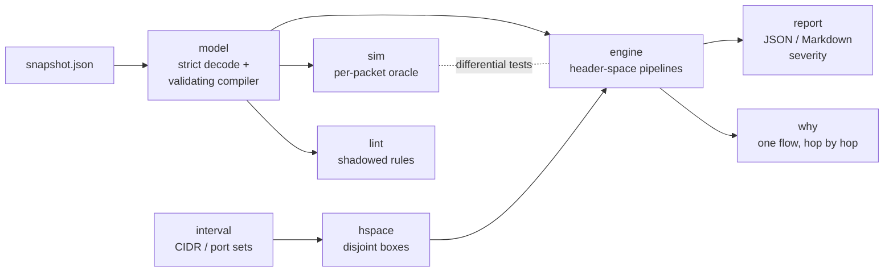

# netreach

Reachability analysis for AWS-style VPC snapshots. netreach answers
**"which instance ports are reachable from the internet (or from that
instance), and why?"** with exact answers and a hop-by-hop explanation for
every class of flows, by doing interval arithmetic over CIDR and port ranges
instead of enumerating packets.

```text
$ netreach why -s testdata/topologies/nat-egress/snapshot.json -from eni-worker -to 8.8.8.8 -proto tcp -port 443 -sport 40000
BLOCKED: worker-1 (eni-worker) -> internet 8.8.8.8 tcp, initiator port 40000 -> service port 443
   1. [ok  ] sg-outbound              sg-worker        outbound rule #1 allows all traffic to 0.0.0.0/0
   2. [ok  ] route                    rtb-priv         0.0.0.0/0 -> nat-n (nat-gateway)
   3. [ok  ] nacl-outbound            acl-priv         outbound rule 100 allow tcp 443 to 0.0.0.0/0 [subnet-priv, source subnet]
   4. [ok  ] nat-nacl-inbound         acl-pub          inbound rule 100 allow all traffic from 10.20.0.0/16 [subnet-pub, NAT subnet]
   5. [ok  ] nat-gateway              nat-n            source translated to 52.20.0.10:1024-65535
   6. [ok  ] nat-route                rtb-pub          0.0.0.0/0 -> igw-n (internet-gateway)
   7. [ok  ] nat-nacl-outbound        acl-pub          outbound rule 100 allow all traffic to 0.0.0.0/0 [subnet-pub, NAT subnet]
   8. [DROP] nat-nacl-inbound-return  acl-pub          inbound denies replies to some NAT ports in 1024-65535 [subnet-pub, NAT subnet]
      denied NAT ports for this destination and protocol: 1024-2047
Same decision for: tcp 443 to 0.0.0.0/0 except 10.20.0.0/16
Reference simulator: agrees
```

## Who it is for

* Cloud and platform engineers who want to know what a VPC configuration
  actually exposes before (or without) deploying it, and why a connection
  that "should work" does not.
* Security reviewers who need exact, explainable answers ("tcp/22 is open to
  0.0.0.0/0 except 198.51.100.0/24 and 10.10.0.0/16, via this NACL rule and
  this security group rule") rather than a list of permissive rules.
* CI pipelines: `netreach analyze -fail-on high` exits 3 when a sensitive
  port faces the internet.

It is an offline, defensive tool: it reads a JSON snapshot you already have
and never touches a cloud API or the network (see
[docs/THREAT_MODEL.md](docs/THREAT_MODEL.md)).

## What it models

VPCs, subnets, route tables (implicit local routes, longest-prefix match,
blackholes), internet gateways, NAT gateways, VPC peering (with status and
non-transitivity), security groups (stateful, union of allow rules, CIDR and
cross-VPC group references), network ACLs (stateless, ordered, first match,
implicit deny, applied in both directions including replies), and ENIs with
private and public IPv4 addresses.

Three questions are answered:

| Query | Command | Path checked |
|---|---|---|
| Internet ingress | `analyze -from internet` or `-from 198.51.100.0/24,...` | IGW, public IP, NACL in, SGs, NACL out (reply), return route must use the same IGW |
| Internal ingress | `analyze -from eni-a` | source SGs out, NACLs on both subnets in both directions, routes (local or active peering) both ways, target SGs |
| Internet egress | `analyze -egress -from eni-x` (or `-from all`) | SGs out, LPM branch to IGW (needs public IP) or NAT gateway (NAT subnet route + NACLs, replies to every NAT port), NACL replies |

## Architecture



A flow is a point in **remote IPv4 × protocol × initiator port × service
port** (about 3.7 × 10^19 points). netreach represents sets of flows as
unions of disjoint boxes whose sides are interval sets, and pushes the whole
queried space through the ordered checks a packet meets:

* **NACLs**: each entry, in rule-number order, claims the part of the
  undecided space it matches; the remainder hits the implicit deny.
* **Security groups**: the union of allow rules partitions the space; each
  part is attributed to the rule that admits it.
* **Routing**: routes sorted by descending prefix length each claim their
  CIDR from the remainder, which is exactly longest-prefix match, computed
  on sets.
* **NAT replies**: AWS may pick any NAT port in 1024-65535, so replies must
  be admitted for *all* of them; this universal quantifier is computed with a
  cylinder (project-out) operation: `¬Cyl(¬Allowed ∩ ports∈1024-65535)`.

Every resulting fragment carries the hops that produced it, which is where
the explanations come from. Details and complexity analysis:
[docs/ARCHITECTURE.md](docs/ARCHITECTURE.md).

## Quickstart

Requires Go 1.23+ (developed with 1.27.1). No third-party dependencies.

```sh
make build                      # bin/netreach
bin/netreach validate -s testdata/topologies/public-web/snapshot.json
bin/netreach analyze  -s testdata/topologies/public-web/snapshot.json            # Markdown
bin/netreach analyze  -s testdata/topologies/public-web/snapshot.json -format json -o report.json
bin/netreach analyze  -s testdata/topologies/peering/snapshot.json -from eni-a   # internal
bin/netreach analyze  -s testdata/topologies/nat-egress/snapshot.json -egress -from all
bin/netreach why      -s testdata/topologies/nacl-ordering/snapshot.json -from 198.51.100.20 -to eni-vpn -port 22
make demo                       # the offline end-to-end demo below
make check                      # every quality gate
```

Snapshot format (excerpt; full examples in `testdata/topologies/*/snapshot.json`):

```json
{
  "name": "public-web",
  "vpcs": [{"id": "vpc-shop", "cidrs": ["10.0.0.0/16"]}],
  "internetGateways": [{"id": "igw-shop", "vpc": "vpc-shop"}],
  "subnets": [{"id": "subnet-public", "vpc": "vpc-shop", "cidr": "10.0.1.0/24",
               "routeTable": "rtb-public", "networkAcl": "acl-default"}],
  "routeTables": [{"id": "rtb-public", "vpc": "vpc-shop",
                   "routes": [{"destination": "0.0.0.0/0", "target": "igw-shop"}]}],
  "networkAcls": [{"id": "acl-default", "vpc": "vpc-shop",
                   "inbound":  [{"ruleNumber": 100, "protocol": "all", "action": "allow", "cidr": "0.0.0.0/0"}],
                   "outbound": [{"ruleNumber": 100, "protocol": "all", "action": "allow", "cidr": "0.0.0.0/0"}]}],
  "securityGroups": [{"id": "sg-web", "vpc": "vpc-shop",
                      "inbound": [{"protocol": "tcp", "ports": "443", "cidr": "0.0.0.0/0"},
                                  {"protocol": "tcp", "ports": "8080", "group": "sg-lb"}],
                      "outbound": [{"protocol": "all", "cidr": "0.0.0.0/0"}]}],
  "enis": [{"id": "eni-web", "subnet": "subnet-public", "privateIp": "10.0.1.20",
            "publicIp": "54.10.0.20", "securityGroups": ["sg-web"]}]
}
```

## Demo

`make demo` runs `scripts/demo.sh` against the bundled fixtures. Excerpts
from a real run (full output is reproduced by the command):

```text
==== 1. Validate and lint every fixture snapshot ====

ok: nacl-ordering: 1 VPCs, 1 subnets, 1 route tables (2 routes), 1 SGs + 1 NACLs (15 rules), 1 ENIs
warning: acl-dmz: inbound rule 130 (allow udp 1194) is shadowed: earlier rule(s) 120 decide every flow it matches
...
ok: route-shadow: 2 VPCs, 4 subnets, 4 route tables (8 routes), 2 SGs + 2 NACLs (8 rules), 3 ENIs
warning: eni-island: has public IP 54.30.0.30 but vpc vpc-noigw has no internet gateway
warning: igw-spare: is not attached to any VPC

==== 2. Hand-derived ground truth: engine and reference simulator vs expected.json ====

fixture           checks  probes  failures
multi-sg              22       7         0
nacl-ordering         19       7         0
nat-egress            23       8         0
peering               27       9         0
public-web            38      15         0
route-shadow          25      10         0
total                154      56         0

==== 3. Internet exposure of the three-tier shop (Markdown report) ====

| Target | Private IP | Public IP | TCP | UDP | Other protocols | Severity |
|---|---|---|---|---|---|---|
| app-1 `eni-app` (i-app1) | 10.0.2.30 | - | - | - | - | - |
| db-1 `eni-db` (i-db1) | 10.0.3.40 | 54.10.0.40 | - | - | - | - |
| web-1 `eni-web` (i-web1) | 10.0.1.20 | 54.10.0.20 | 22,80,443 | - | - | low |

## db-1 `eni-db` (i-db1)
**Not reachable.**
| Step | Component | Detail | Flows |
|---|---|---|---|
| sg-inbound | sg-db | no inbound rule in sg-db allows this traffic | tcp 0-5431,5433-65535; udp all ports; proto 0-5,7-16,18-255 |
| route-return | rtb-private | 10.0.0.0/16 -> local (local); return traffic would not leave through igw-shop (asymmetric path, dropped) | tcp 5432 |
| route-return | rtb-private | 0.0.0.0/0 -> nat-shop (nat-gateway); return traffic would not leave through igw-shop (asymmetric path, dropped) | tcp 5432 |

## web-1 `eni-web` (i-web1)
| Severity | Protocol | Ports | Sources | Initiator ports | Reason |
|---|---|---|---|---|---|
| low | tcp | 22 | 203.0.113.0/24 | 0-65535 | from a restricted source range |
| info | tcp | 80 | 0.0.0.0/0 except 10.0.0.0/16 | 0-65535 | web ports open to the internet |
| info | tcp | 443 | 0.0.0.0/0 except 10.0.0.0/16 | 0-65535 | web ports open to the internet |

- tcp 22 from 203.0.113.0/24
  1. `internet-gateway` igw-shop: enters vpc vpc-shop through igw-shop
  2. `public-ip` eni-web: public 54.10.0.20 maps to private 10.0.1.20
  3. `nacl-inbound` acl-default: inbound rule 100 allow all traffic from 0.0.0.0/0 [subnet-public, target subnet]
  4. `sg-inbound` sg-web: inbound rule #3 allows tcp 22 from 203.0.113.0/24 (office ssh)
  5. `nacl-outbound-return` acl-default: outbound rule 100 allow all traffic to 0.0.0.0/0 [subnet-public, target subnet]
  6. `route-return` rtb-public: 0.0.0.0/0 -> igw-shop (internet-gateway); return traffic leaves through the internet gateway

==== 4. Why is SSH from 198.51.100.20 blocked on the VPN gateway? ====

BLOCKED: internet 198.51.100.20 -> vpn-gw (eni-vpn) tcp, initiator port 40000 -> service port 22
   1. [ok  ] internet-gateway         igw-edge         enters vpc vpc-edge through igw-edge
   2. [ok  ] public-ip                eni-vpn          public 54.20.0.5 maps to private 10.10.0.5
   3. [DROP] nacl-inbound             acl-dmz          inbound rule 90 deny tcp 22 from 198.51.100.0/24 [subnet-dmz, target subnet]
Same decision for: tcp 22 from 198.51.100.0/24
Reference simulator: agrees

==== 7. CI gate: fail when anything high-severity faces the internet ====

netreach: finding at or above high: high tcp 22 on eni-vpn
exit code 3 (3 = findings at or above the threshold), as intended
```

Note what the shop example shows: `db-1` has a public IP *and* a
`tcp 5432 from 0.0.0.0/0` "temporary debugging" rule, yet it is not exposed,
because its subnet routes replies to the NAT gateway instead of the internet
gateway. netreach reports both facts: not reachable, and exactly which hop
saves it.

## Verification and evaluation

Every number below comes from a committed command; run it to reproduce.

| What | Command | Result (development machine) |
|---|---|---|
| All gates | `make check` | gofmt clean, `go vet` clean, golangci-lint **0 issues**, race-enabled tests pass |
| Core coverage | `make cover` | **97.9%** of statements in interval, hspace, model, engine, sim, report |
| Ground truth on 6 hand-built topologies | `make verify` | **154 checks, 56 probes, 0 failures** (engine *and* simulator vs hand-derived `expected.json`) |
| Differential test vs reference simulator | `go test ./engine -run Differential -v` | **128,000** boundary-biased flows on 40 generated topologies agree on verdict and deciding hop (3,066 allowed, 124,934 blocked; every pipeline step decides at least one flow) |
| Interval algebra vs brute force | `go test ./interval -run Property` | 5,000 random pairs vs a bitset oracle on a 64-value domain, incl. minimal CIDR decomposition |
| Header-space algebra vs brute force | `go test ./hspace -run Property` | 1,500 random pairs vs enumeration of a 1,024-point 4-D domain |
| Fuzzing | `make fuzz` | native Go fuzzing of interval identities over the full 32-bit domain |

The fixtures each target a classic trap: NACL rule ordering and shadowing
(`nacl-ordering`), ephemeral-port return rules, asymmetric return routes and
blackholes (`route-shadow`), peering non-transitivity and pending peerings
(`peering`), the NAT port-range quantifier (`nat-egress`), SG unions and
same-subnet NACL bypass (`multi-sg`), and a three-tier app with a near-miss
database (`public-web`). The ground truth was derived by hand, not generated
by the engine (DATA.md, DECISIONS.md).

### Benchmarks

`make bench` (equivalently `bin/netreach bench`), median of 3 runs on an
Apple M1 Pro shared with other jobs, so treat timings as indicative. Topologies
are generated by `topogen` (seed 7); each row is a different random topology,
so timings follow rule interactions as much as size.

```text
Scale-out (4 subnets x 4 ENIs per VPC, 8 SG rules, 10 NACL rules/direction, seed 7)

| Shape | ENIs | Rules | Internet ingress (all ENIs) | Egress (all ENIs) | Internal (1 src -> all) | Fragments | Boxes |
|---|---|---|---|---|---|---|---|
| 1 VPCs | 16 | 82 | 8.67ms | 1.83ms | 1.27ms | 230 | 365 |
| 2 VPCs | 32 | 158 | 3.28ms | 7.57ms | 4.87ms | 163 | 283 |
| 4 VPCs | 64 | 318 | 14.19ms | 14.65ms | 7.85ms | 552 | 944 |
| 8 VPCs | 128 | 635 | 38.61ms | 42.18ms | 1.51ms | 1429 | 2349 |

Rule depth (2 VPCs, 4 subnets x 4 ENIs each, seed 7)

| Shape | ENIs | Rules | Internet ingress (all ENIs) | Egress (all ENIs) | Internal (1 src -> all) | Fragments | Boxes |
|---|---|---|---|---|---|---|---|
| 5 rules | 32 | 95 | 5.21ms | 2.68ms | 1.4ms | 236 | 412 |
| 10 rules | 32 | 175 | 3.45ms | 6.1ms | 710µs | 144 | 245 |
| 20 rules | 32 | 337 | 18.74ms | 13.93ms | 17.43ms | 787 | 1023 |
| 40 rules | 32 | 659 | 45.15ms | 84.72ms | 41.51ms | 1440 | 1713 |
| 80 rules | 32 | 1296 | 79.17ms | 61.81ms | 14.59ms | 2141 | 2507 |
```

Larger shapes, `bin/netreach bench -sizes 16,32 -depths 160`: 512 ENIs with
2,542 rules took 153 ms for internet exposure of every ENI; 32 ENIs behind
160-rule NACLs and SGs (2,575 rules) took 147 ms.

## Design decisions

The full list with trade-offs is in [DECISIONS.md](DECISIONS.md). Highlights:

* **Exact sets, not sampling.** Results partition the queried flow space
  exactly; the differential test asserts that for every query.
* **Canonical interval sets and disjoint boxes** keep equality, subtraction
  and membership exact and cheap.
* **An independent oracle.** `sim` evaluates one packet with plain rule
  comparisons, its own LPM and a 64,512-iteration NAT port loop; `why`
  cross-checks every answer against it.
* **Conservative where AWS is nondeterministic.** NAT replies must be
  admitted for every possible NAT port; asymmetric return paths are drops.
* **Strict input.** Unknown JSON fields, dangling references, overlapping
  CIDRs, unsupported route targets and more-specific-than-local routes are
  validation errors, all reported at once.
* **No dependencies.** Standard library only.

## Limitations

* **Model coverage.** Not modelled: IPv6, load balancers (ALB/NLB/GWLB),
  transit gateways, VPN and Direct Connect, VPC endpoints and PrivateLink,
  network firewall appliances, middlebox (ENI) route targets, egress-only
  gateways, prefix lists, secondary private IPs and multiple public IPs per
  ENI, ICMP type/code filtering, and cross-region peering subtleties. A
  service exposed only through one of these is **not reported** (a false
  negative).
* **No AWS exporter.** netreach consumes its own JSON schema (field names
  follow the AWS API). Converting `aws ec2 describe-*` output is a thin but
  unwritten mapping; it has not been tested against real account exports.
* **Snapshot, not live state.** The answer is only as good as the export:
  OS firewalls, listening sockets and application authorization are out of
  scope.
* **Severity is heuristic.** A short, explicit list of sensitive ports and a
  "/8 or wider" notion of broad exposure; internal and egress results are not
  graded.
* **Worst-case cost.** Header spaces have polynomial worst-case growth in the
  number of overlapping rules (O(n^4) boxes for n rule boxes in 4
  dimensions). Observed behaviour on generated topologies is near-linear,
  but no resource limits are enforced; an adversarial snapshot could be slow.
* **Evaluation data is synthetic.** Fixtures are hand-built and topologies in
  the differential test are random; neither is a real production network.
  Generated topologies produce mostly blocked flows (2.4% of the sampled
  flows are allowed), so allowed paths get fewer differential samples than
  blocked ones.
* **CI is untested.** `.github/workflows/ci.yml` runs the same gates, but
  this repository has not been pushed, so the workflow has never executed.

## Roadmap

* An exporter from `aws ec2 describe-vpcs/subnets/route-tables/...` JSON.
* Load balancers and VPC endpoints as first-class hops; transit gateway
  route tables.
* IPv6 (128-bit intervals) and prefix lists.
* Diff mode: what became reachable between two snapshots.
* SARIF output for code-scanning integrations.

## License

MIT, see [LICENSE](LICENSE).
