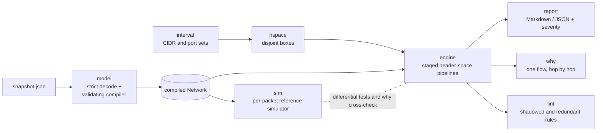

# netreach

Exact, explainable reachability analysis for AWS-style VPC snapshots: which
instance ports are reachable from the internet, from another instance, or out
to the internet, and which rule decided each answer.

[](https://github.com/SlateGitOrg/netreach/actions/workflows/ci.yml)

```text
$ netreach why -s testdata/topologies/nat-egress/snapshot.json -from eni-worker -to 8.8.8.8 -proto tcp -port 443 -sport 40000
BLOCKED: worker-1 (eni-worker) -> internet 8.8.8.8 tcp, initiator port 40000 -> service port 443
   1. [ok  ] sg-outbound              sg-worker        outbound rule #1 allows all traffic to 0.0.0.0/0
   2. [ok  ] route                    rtb-priv         0.0.0.0/0 -> nat-n (nat-gateway)
   3. [ok  ] nacl-outbound            acl-priv         outbound rule 100 allow tcp 443 to 0.0.0.0/0 [subnet-priv, source subnet]
   4. [ok  ] nat-nacl-inbound         acl-pub          inbound rule 100 allow all traffic from 10.20.0.0/16 [subnet-pub, NAT subnet]
   5. [ok  ] nat-gateway              nat-n            source translated to 52.20.0.10:1024-65535
   6. [ok  ] nat-route                rtb-pub          0.0.0.0/0 -> igw-n (internet-gateway)
   7. [ok  ] nat-nacl-outbound        acl-pub          outbound rule 100 allow all traffic to 0.0.0.0/0 [subnet-pub, NAT subnet]
   8. [DROP] nat-nacl-inbound-return  acl-pub          inbound denies replies to some NAT ports in 1024-65535 [subnet-pub, NAT subnet]
      denied NAT ports for this destination and protocol: 1024-2047
Same decision for: tcp 443 to 0.0.0.0/0 except 10.20.0.0/16
Reference simulator: agrees
```

## Why

Whether a packet reaches an instance in a VPC depends on several mechanisms
with different semantics: security groups are stateful unions of allow
rules, network ACLs are stateless, ordered and applied to replies too, route
tables use longest-prefix match on both the forward and the return path, and
a NAT gateway may pick any of 64,512 source ports. Reading rules one at a time
misses their interactions, and probing with test packets only samples a space
of about 3.7 × 10^19 flows. netreach computes the exact set of flows a
configuration admits, splits it by the hop that decides each part, and prints
the rule behind every verdict. It works offline on a JSON snapshot and never
calls a cloud API or sends a packet ([threat model](docs/THREAT_MODEL.md)).

## Features

* **Three queries.** Internet ingress to every ENI, internal ingress from one
  ENI (same VPC or across VPC peering), and internet egress through an
  internet gateway or a NAT gateway.
* **Exact answers.** Sets of flows are unions of disjoint boxes over remote
  address × protocol × initiator port × service port; nothing is sampled, and
  every result partitions the queried space.
* **`why` for one flow.** A hop-by-hop trace, the whole class of flows that
  share the decision, and a cross-check against an independent per-packet
  simulator.
* **Reports.** Markdown or JSON, open ports and sources per target, severity
  grading for internet exposure, and `-fail-on SEV` (exit code 3) for CI.
* **Validation and lint.** Strict decoding (unknown fields rejected), all
  reference and CIDR errors reported at once, plus warnings for shadowed NACL
  entries, redundant SG rules, NAT gateways without an internet route, public
  IPs in VPCs without an IGW, and detached IGWs.
* **Built-in evidence.** `verify` checks six hand-built fixtures against
  hand-derived ground truth; `gen` and `bench` create and time random
  topologies.
* **No dependencies.** Standard library only.

What is modelled: VPCs, subnets, route tables (implicit local routes,
longest-prefix match, blackholes), internet gateways, NAT gateways, VPC
peering (status, non-transitive), security groups (stateful, CIDR and
cross-VPC group references), network ACLs (stateless, ordered, implicit deny,
both directions) and ENIs with private and public IPv4 addresses.

## Architecture



`model` decodes the snapshot strictly and compiles it into a cross-linked
`Network` (references resolved, routes sorted for longest-prefix match).
`engine` builds one pipeline of stages per query and pushes the whole queried
flow space through it; each stage splits the incoming fragments into the
parts it passes and the parts it blocks, and records the hop. `report` turns
the surviving fragments into per-target exposure tables, and `why` finds the
fragment that contains a single flow. `sim` shares only the compiled model and
re-implements the checks packet by packet, so it can catch engine bugs instead
of repeating them. Package-by-package detail and complexity analysis:
[docs/ARCHITECTURE.md](docs/ARCHITECTURE.md).

## Quick start

Prerequisites: Go 1.23 or newer (CI runs 1.23 and 1.27) and `make`.
[golangci-lint](https://golangci-lint.run) v2.14 or newer is needed only for
`make lint` / `make check` (CI pins v2.15.0). There are no third-party Go
modules to download.

```sh
make build        # builds bin/netreach
bin/netreach validate -s testdata/topologies/public-web/snapshot.json
bin/netreach analyze  -s testdata/topologies/public-web/snapshot.json
bin/netreach why      -s testdata/topologies/nacl-ordering/snapshot.json -from 198.51.100.20 -to eni-vpn -port 22
make test         # unit, property, differential, ground-truth and golden tests
make demo         # scripted offline walk-through of every command
```

## Usage

```text
netreach analyze  -s SNAPSHOT [-from SRC] [-egress] [-to CIDRS] [-target ENI] [-format md|json] [-o FILE] [-fail-on SEV]
netreach why      -s SNAPSHOT -from SRC -to DST [-proto P] [-port N] [-sport N]
netreach validate -s SNAPSHOT
netreach verify   [-dir DIR]
netreach gen      [-seed N] [-vpcs N] [-subnets N] [-enis N] [-rules N] [-o FILE]
netreach bench    [-sizes LIST] [-depths LIST] [-seed N]
```

`SRC` is `internet`, one or more comma-separated CIDRs (treated as internet
sources), or an ENI or instance ID. Run `netreach COMMAND -h` for every flag.

| Question | Command | Path checked |
|---|---|---|
| Internet ingress | `analyze` (default `-from internet`) or `-from 198.51.100.0/24,...` | IGW, public IP, NACL in, SGs, NACL out for the reply, return route through the same IGW |
| Internal ingress | `analyze -from eni-a` | source SGs out, NACLs on both subnets in both directions, routes (local or active peering) both ways, target SGs |
| Internet egress | `analyze -egress -from eni-x` or `-from all` | SGs out, LPM branch to the IGW (needs a public IP) or a NAT gateway (NAT subnet route and NACLs, replies to every NAT port), NACL replies |

### Internet exposure report

```text
$ bin/netreach analyze -s testdata/topologies/public-web/snapshot.json
# netreach report: public-web

- Query: **internet-ingress** from `internet`
- Remote source addresses: `0.0.0.0/0`
- Targets: 3 analysed, 1 reachable
- Findings: 1 low, 2 info
- Generated by netreach 0.1.0

## Summary

| Target | Private IP | Public IP | TCP | UDP | Other protocols | Severity |
|---|---|---|---|---|---|---|
| app-1 `eni-app` (i-app1) | 10.0.2.30 | - | - | - | - | - |
| db-1 `eni-db` (i-db1) | 10.0.3.40 | 54.10.0.40 | - | - | - | - |
| web-1 `eni-web` (i-web1) | 10.0.1.20 | 54.10.0.20 | 22,80,443 | - | - | low |

...
## db-1 `eni-db` (i-db1)

Subnet `subnet-db` in `vpc-shop`.

**Not reachable.**

Blocked flows (deciding hop):

| Step | Component | Detail | Flows |
|---|---|---|---|
| sg-inbound | sg-db | no inbound rule in sg-db allows this traffic | tcp 0-5431,5433-65535; udp all ports; proto 0-5,7-16,18-255 |
| route-return | rtb-private | 10.0.0.0/16 -> local (local); return traffic would not leave through igw-shop (asymmetric path, dropped) | tcp 5432 |
| route-return | rtb-private | 0.0.0.0/0 -> nat-shop (nat-gateway); return traffic would not leave through igw-shop (asymmetric path, dropped) | tcp 5432 |

## web-1 `eni-web` (i-web1)

Subnet `subnet-public` in `vpc-shop`.

| Severity | Protocol | Ports | Sources | Initiator ports | Reason |
|---|---|---|---|---|---|
| low | tcp | 22 | 203.0.113.0/24 | 0-65535 | from a restricted source range |
| info | tcp | 80 | 0.0.0.0/0 except 10.0.0.0/16 | 0-65535 | web ports open to the internet |
| info | tcp | 443 | 0.0.0.0/0 except 10.0.0.0/16 | 0-65535 | web ports open to the internet |

Paths:

- tcp 22 from 203.0.113.0/24
  1. `internet-gateway` igw-shop: enters vpc vpc-shop through igw-shop
  2. `public-ip` eni-web: public 54.10.0.20 maps to private 10.0.1.20
  3. `nacl-inbound` acl-default: inbound rule 100 allow all traffic from 0.0.0.0/0 [subnet-public, target subnet]
  4. `sg-inbound` sg-web: inbound rule #3 allows tcp 22 from 203.0.113.0/24 (office ssh)
  5. `nacl-outbound-return` acl-default: outbound rule 100 allow all traffic to 0.0.0.0/0 [subnet-public, target subnet]
  6. `route-return` rtb-public: 0.0.0.0/0 -> igw-shop (internet-gateway); return traffic leaves through the internet gateway
...
```

The database is the interesting row: `db-1` has a public IP and a
`tcp 5432 from 0.0.0.0/0` rule, yet it is not exposed, because its subnet
routes replies to the NAT gateway instead of the internet gateway. The report
states both facts: not reachable, and exactly which hop prevents it.

### Explaining one flow

```text
$ bin/netreach why -s testdata/topologies/nacl-ordering/snapshot.json -from 198.51.100.20 -to eni-vpn -port 22
BLOCKED: internet 198.51.100.20 -> vpn-gw (eni-vpn) tcp, initiator port 49152 -> service port 22
   1. [ok  ] internet-gateway         igw-edge         enters vpc vpc-edge through igw-edge
   2. [ok  ] public-ip                eni-vpn          public 54.20.0.5 maps to private 10.10.0.5
   3. [DROP] nacl-inbound             acl-dmz          inbound rule 90 deny tcp 22 from 198.51.100.0/24 [subnet-dmz, target subnet]
Same decision for: tcp 22 from 198.51.100.0/24
Reference simulator: agrees
```

### Other queries and CI use

```sh
bin/netreach analyze -s testdata/topologies/peering/snapshot.json -from eni-a          # internal, across peerings
bin/netreach analyze -s testdata/topologies/nat-egress/snapshot.json -egress -from all # egress via IGW and NAT
bin/netreach analyze -s testdata/topologies/public-web/snapshot.json -format json      # machine-readable report
bin/netreach analyze -s testdata/topologies/nacl-ordering/snapshot.json -fail-on high  # exits 3 on a high finding
```

```text
$ bin/netreach analyze -s testdata/topologies/nacl-ordering/snapshot.json -fail-on high > /dev/null; echo "exit=$?"
netreach: finding at or above high: high tcp 22 on eni-vpn
exit=3

$ bin/netreach validate -s testdata/topologies/nacl-ordering/snapshot.json
ok: nacl-ordering: 1 VPCs, 1 subnets, 1 route tables (2 routes), 1 SGs + 1 NACLs (15 rules), 1 ENIs
warning: acl-dmz: inbound rule 130 (allow udp 1194) is shadowed: earlier rule(s) 120 decide every flow it matches
```

Exit codes: `0` success, `1` runtime error or verification mismatch, `2` bad
flags or invalid snapshot, `3` a finding at or above the `-fail-on` threshold.

### Snapshot format

Field names follow the AWS EC2 API. Excerpt (complete examples in
`testdata/topologies/*/snapshot.json`):

```json
{
  "name": "public-web",
  "vpcs": [{"id": "vpc-shop", "cidrs": ["10.0.0.0/16"]}],
  "internetGateways": [{"id": "igw-shop", "vpc": "vpc-shop"}],
  "subnets": [{"id": "subnet-public", "vpc": "vpc-shop", "cidr": "10.0.1.0/24",
               "routeTable": "rtb-public", "networkAcl": "acl-default"}],
  "routeTables": [{"id": "rtb-public", "vpc": "vpc-shop",
                   "routes": [{"destination": "0.0.0.0/0", "target": "igw-shop"}]}],
  "networkAcls": [{"id": "acl-default", "vpc": "vpc-shop",
                   "inbound":  [{"ruleNumber": 100, "protocol": "all", "action": "allow", "cidr": "0.0.0.0/0"}],
                   "outbound": [{"ruleNumber": 100, "protocol": "all", "action": "allow", "cidr": "0.0.0.0/0"}]}],
  "securityGroups": [{"id": "sg-web", "vpc": "vpc-shop",
                      "inbound": [{"protocol": "tcp", "ports": "443", "cidr": "0.0.0.0/0"},
                                  {"protocol": "tcp", "ports": "8080", "group": "sg-lb"}],
                      "outbound": [{"protocol": "all", "cidr": "0.0.0.0/0"}]}],
  "enis": [{"id": "eni-web", "subnet": "subnet-public", "privateIp": "10.0.1.20",
            "publicIp": "54.10.0.20", "securityGroups": ["sg-web"]}]
}
```

## How it works

A flow is a point in **remote IPv4 × protocol × initiator port × service
port**. TCP and UDP use both port dimensions; every other protocol is pinned
to port 0, so each real flow has exactly one canonical point. netreach
represents sets of flows as unions of disjoint boxes whose sides are
canonical interval sets, and pushes the whole queried space through the
ordered checks a packet meets:

* **NACLs.** Each entry, in rule-number order, claims the part of the
  undecided space it matches; the remainder hits the implicit deny. Replies
  are checked against the opposite-direction NACL, where the packet's
  destination port is the initiator port.
* **Security groups.** The union of allow rules partitions the space; each
  part is attributed to the first rule that admits it, so the explanation can
  name one rule.
* **Routing.** Routes sorted by descending prefix length each claim their
  CIDR from the remainder, which is longest-prefix match computed on sets.
  Internet ingress also requires the return route to use the same IGW.
* **NAT replies.** AWS may pick any NAT port in 1024-65535, so replies must be
  admitted for all of them. That universal quantifier is computed with a
  cylinder (project-out) operation, `¬Cyl(¬Allowed ∩ ports∈1024-65535)`,
  which is why `why` can list exactly which NAT ports a NACL denies.

After every stage, fragments with identical hop sequences are merged, so the
work tracks the number of distinct decision paths rather than box
fragmentation. Every fragment carries the hops that produced it, which is
where the explanations come from.

Design decisions (the full list with trade-offs is in
[DECISIONS.md](DECISIONS.md)):

* **Exact sets, not sampling.** Results partition the queried flow space; the
  differential test asserts it for every query.
* **An independent oracle.** `sim` evaluates one packet with plain rule
  comparisons, its own LPM and a 64,512-iteration NAT port loop.
* **Conservative where AWS is nondeterministic.** NAT replies must be admitted
  for every possible NAT port; asymmetric return paths count as drops.
* **Strict input.** Unknown JSON fields, dangling references, overlapping VPC
  CIDRs, unsupported route targets and routes more specific than the local
  route are validation errors, reported together.

### Evidence

Every number below comes from a committed command; run it to reproduce.

| What | Command | Result |
|---|---|---|
| All gates | `make check` | gofmt clean, `go vet` clean, golangci-lint 0 issues, race-enabled tests pass |
| Core coverage | `make cover` | **97.8%** of statements in interval, hspace, model, engine, sim, report (gate: 85%) |
| Ground truth on 6 hand-built topologies | `make verify` | **154 checks, 56 probes, 0 failures** (engine and simulator vs hand-derived `expected.json`) |
| Differential test vs reference simulator | `go test ./engine -run Differential -v` | **128,000** boundary-biased flows on 40 generated topologies agree on verdict and deciding hop (3,066 allowed, 124,934 blocked; every pipeline step decides at least one flow) |
| Interval algebra vs brute force | `go test ./interval -run Property` | 5,000 random pairs vs a bitset oracle on a 64-value domain, including minimal CIDR decomposition |
| Header-space algebra vs brute force | `go test ./hspace -run Property` | 1,500 random pairs vs enumeration of a 1,024-point 4-D domain |
| Fuzzing | `make fuzz` | native Go fuzzing of interval identities over the full 32-bit domain |

The fixtures each target a classic trap: NACL rule ordering and shadowing
(`nacl-ordering`), ephemeral-port return rules, asymmetric return routes and
blackholes (`route-shadow`), peering non-transitivity and pending peerings
(`peering`), the NAT port-range quantifier (`nat-egress`), SG unions and
same-subnet NACL bypass (`multi-sg`), and a three-tier app with a near-miss
database (`public-web`). The ground truth was derived by hand from the rules,
not generated by the engine ([DATA.md](DATA.md)).

### Benchmarks

`make bench` (equivalently `bin/netreach bench`), median of 3 runs on an
Apple M1 Pro shared with other jobs, so treat timings as indicative. Topologies
are generated by `topogen` (seed 7); each row is a different random topology,
so timings follow rule interactions as much as size.

```text
Scale-out (4 subnets x 4 ENIs per VPC, 8 SG rules, 10 NACL rules/direction, seed 7)

| Shape | ENIs | Rules | Internet ingress (all ENIs) | Egress (all ENIs) | Internal (1 src -> all) | Fragments | Boxes |
|---|---|---|---|---|---|---|---|
| 1 VPCs | 16 | 82 | 8.67ms | 1.83ms | 1.27ms | 230 | 365 |
| 2 VPCs | 32 | 158 | 3.28ms | 7.57ms | 4.87ms | 163 | 283 |
| 4 VPCs | 64 | 318 | 14.19ms | 14.65ms | 7.85ms | 552 | 944 |
| 8 VPCs | 128 | 635 | 38.61ms | 42.18ms | 1.51ms | 1429 | 2349 |

Rule depth (2 VPCs, 4 subnets x 4 ENIs each, seed 7)

| Shape | ENIs | Rules | Internet ingress (all ENIs) | Egress (all ENIs) | Internal (1 src -> all) | Fragments | Boxes |
|---|---|---|---|---|---|---|---|
| 5 rules | 32 | 95 | 5.21ms | 2.68ms | 1.4ms | 236 | 412 |
| 10 rules | 32 | 175 | 3.45ms | 6.1ms | 710µs | 144 | 245 |
| 20 rules | 32 | 337 | 18.74ms | 13.93ms | 17.43ms | 787 | 1023 |
| 40 rules | 32 | 659 | 45.15ms | 84.72ms | 41.51ms | 1440 | 1713 |
| 80 rules | 32 | 1296 | 79.17ms | 61.81ms | 14.59ms | 2141 | 2507 |
```

Larger shapes, `bin/netreach bench -sizes 16,32 -depths 160`: 512 ENIs with
2,542 rules took 153 ms for internet exposure of every ENI; 32 ENIs behind
160-rule NACLs and SGs (2,575 rules) took 147 ms.

## Testing

| Command | What it runs |
|---|---|
| `make test` | all unit, property, differential, ground-truth and golden-output tests |
| `make race` | the same suite with the race detector |
| `make cover` | whole-suite coverage of the core packages, failing below 85% |
| `make verify` | engine and simulator against the hand-derived `expected.json` of every fixture |
| `make fuzz` | 30 s of native fuzzing of the interval set algebra |
| `make check` | gofmt, `go vet`, golangci-lint, race tests and the coverage gate (what CI runs, followed by `make verify`, `make demo` and a short fuzz run) |

Golden Markdown, JSON and `why` outputs live in
`internal/cli/testdata/golden`; regenerate them with
`go test ./internal/cli -update` and review the diff.

## Project layout

```text
cmd/netreach/          main package
internal/cli/          command implementations, golden-output tests
internal/groundtruth/  fixture checks against hand-derived expected.json
interval/              canonical uint32 interval sets, CIDR parsing and decomposition
hspace/                header spaces: unions of disjoint boxes, cylinder, compaction
model/                 snapshot schema, strict decoder, validating compiler
engine/                flow space, stages, the three pipelines, lint
sim/                   per-packet reference simulator
report/                exposure projections, severity, Markdown/JSON rendering
topogen/               random valid topologies for tests and benchmarks
testdata/topologies/   six fixture snapshots with expected.json ground truth
scripts/               demo and coverage-gate scripts
docs/                  ARCHITECTURE.md, THREAT_MODEL.md
```

## Limitations

* **Model coverage.** Not modelled: IPv6, load balancers (ALB/NLB/GWLB),
  transit gateways, VPN and Direct Connect, VPC endpoints and PrivateLink,
  network firewall appliances, middlebox (ENI) route targets, egress-only
  gateways, prefix lists, secondary private IPs and multiple public IPs per
  ENI, ICMP type/code filtering, and cross-region peering subtleties. A
  service exposed only through one of these is **not reported** (a false
  negative).
* **No AWS exporter.** netreach reads its own JSON schema, whose field names
  follow the AWS API. Converting `aws ec2 describe-*` output is a thin mapping
  that has not been written, and the tool has not been run against real
  account exports.
* **Snapshot, not live state.** The answer is only as good as the export; OS
  firewalls, listening sockets and application authorization are out of
  scope.
* **Severity is heuristic.** A short, explicit list of sensitive ports and a
  "/8 or wider" notion of broad exposure; internal and egress results are not
  graded.
* **Worst-case cost.** Header spaces have polynomial worst-case growth in the
  number of overlapping rules (O(n^4) boxes for n rule boxes in 4
  dimensions). Generated topologies show near-linear behaviour, but no
  resource limits are enforced, so an adversarial snapshot could be slow.
* **Synthetic evaluation data.** Fixtures are hand-built and the differential
  topologies are random; neither is a production network. Only 2.4% of the
  sampled differential flows are allowed, so allowed paths get fewer samples
  than blocked ones.

Not yet built: an exporter from `aws ec2 describe-*` JSON, load balancers and
VPC endpoints as hops, transit gateway route tables, IPv6 and prefix lists, a
diff mode between two snapshots, and SARIF output.

## License

MIT — see [LICENSE](LICENSE).
