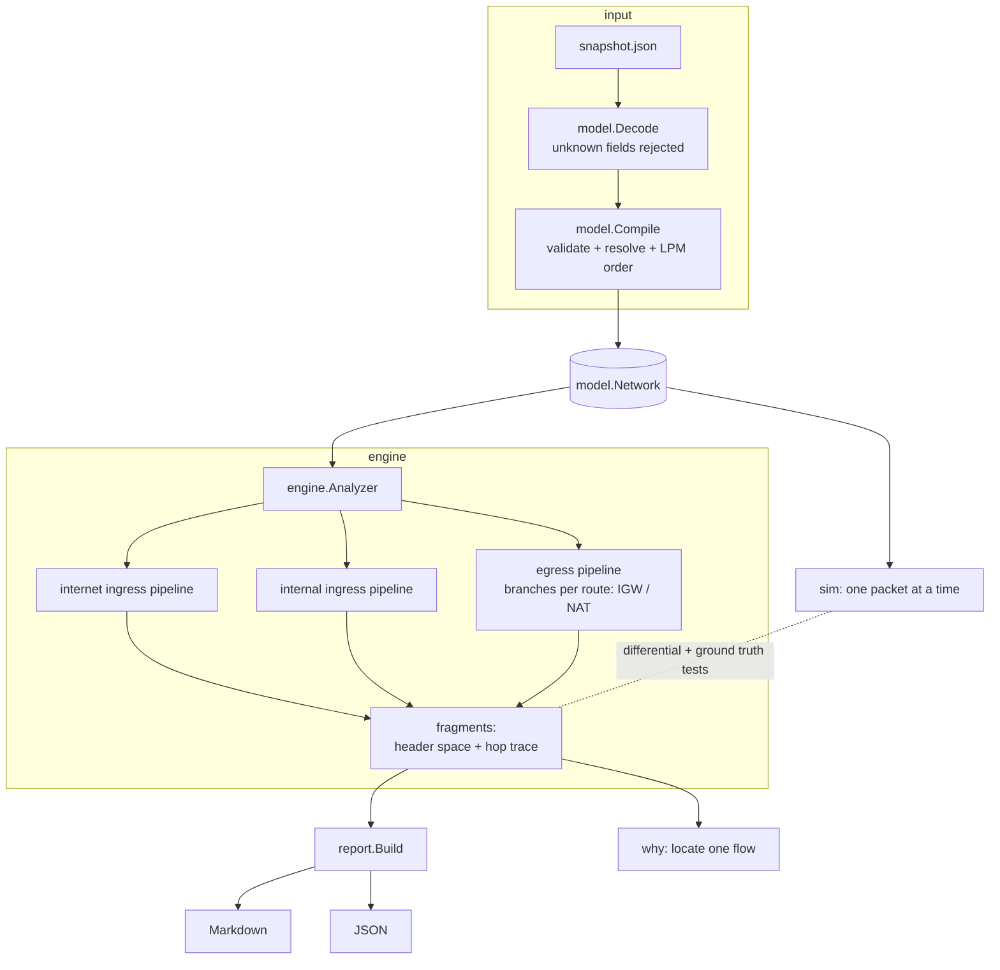

# netreach architecture

This document describes how netreach turns a VPC snapshot into exact
reachability answers, and why it never has to enumerate packets.

## Module map

| Package | Role | Depends on |
|---|---|---|
| `interval` | Canonical sets of `uint32` as sorted disjoint ranges; IPv4 CIDR parsing; minimal prefix decomposition | stdlib |
| `hspace` | Header spaces: unions of disjoint boxes in a product of integer domains | `interval` |
| `model` | Snapshot JSON schema, strict decoder, validating compiler into a cross-linked `Network` | `interval` |
| `engine` | The analysis: flow space, stages (NACL, SG, LPM routing, gates, quantified constraints), pipelines for the three query kinds, lint | `hspace`, `model` |
| `sim` | Reference per-packet simulator (oracle for tests and `why`) | `model` |
| `report` | Projections (open ports, sources per port), severity grading, JSON/Markdown rendering | `engine` |
| `topogen` | Random valid snapshots for differential tests and benchmarks | `model` |
| `internal/groundtruth` | Checks fixtures against hand-derived `expected.json` | `engine`, `sim`, `report` |
| `internal/cli`, `cmd/netreach` | Command line | all |



## The flow space

Every question is about a fixed ENI (the target for ingress, the source for
egress), so the flow space has four dimensions:

| Dim | Name | Domain |
|---|---|---|
| 0 | remote IPv4 address (source for ingress, destination for egress) | 0 .. 2^32-1 |
| 1 | IP protocol | 0 .. 255 |
| 2 | initiator port (the client's port) | 0 .. 65535 |
| 3 | service port (the port connected to) | 0 .. 65535 |

The universe is `tcp/udp × all ports ∪ other protocols × {0} × {0}`, so a
flow has exactly one canonical point. A query begins with the universe
restricted to the queried remote addresses (all of IPv4 by default, a single
address for internal queries).

Brute force over this space is out of the question: it has
2^32 · 2 · 2^32 + 2^32 · 254 ≈ 3.7 × 10^19 points. netreach never visits
points; it manipulates sets.

## Interval sets (`interval`)

A `Set` is a slice of ranges `[lo, hi]` kept sorted, disjoint and
non-adjacent. That invariant makes the representation canonical, so equality
is slice equality. All operations are linear merges:

| Operation | Time | Notes |
|---|---|---|
| Union, Intersect, Subtract | O(n + m) | two-pointer merge |
| Complement | O(n) | subtract from `[0, max]` |
| Contains | O(log n) | binary search |
| AlignedBlocks / CIDRs | O(n · w) | w = 32 for IPv4 |

`AlignedBlocks` returns the *unique minimum* decomposition into aligned
power-of-two blocks (CIDRs for IPv4). Aligned blocks either nest or are
disjoint, so the maximal blocks contained in the set partition it, and the
greedy "largest aligned block that fits from here" emits exactly those.
The property test checks the result against a brute-force enumeration of all
maximal aligned blocks on a 64-value domain.

## Header spaces (`hspace`)

A `Space` is a list of boxes, each box an interval set per dimension. The
boxes are pairwise disjoint and non-empty. The key operation is box
subtraction:

```
a \ o  =  ⋃_i  (a∩o)_0 × … × (a∩o)_{i-1} × (a_i \ o_i) × a_{i+1} × … × a_{d-1}
```

The pieces are disjoint (piece *i* and any later piece differ in dimension
*i*), at most *d* of them are non-empty, and together with `a ∩ o` they cover
`a`. `Union(s, o)` is `s` plus the disjoint remainder `o \ s`.

`Compact` merges boxes that agree in every dimension but one, using a hash of
the other dimensions; it never changes the point set.

`Cylinder(dim)` forgets one dimension (sets it to its full domain). With
complement it expresses a universal quantifier:

```
{ x : ∀y ∈ Y. (x, y) ∈ A }  =  ¬ Cylinder( ¬A ∩ (dim ∈ Y) )
```

### Complexity of header-space operations

Let a space have *B* boxes, *d* = 4 dimensions, and *k* ranges per dimension
set.

| Operation | Time | Output size |
|---|---|---|
| Intersect(s, o) | O(B_s · B_o · d · k) | ≤ B_s · B_o boxes |
| Subtract(s, o) | O(B_s · B_o · d · k) per surviving piece | ≤ B_s · d^{B_o} pieces before compaction (see below) |
| Union(s, o) | as Subtract(o, s) | B_s + |o \ s| |
| Compact | O(B · d · k) per pass | ≤ B |
| Cylinder | O(B² · d · k) | ≤ B |

The `d^{B_o}` bound for one chain of subtractions is loose. A tighter bound
comes from the arrangement: every piece produced is a union of cells of the
grid induced by the endpoints of the *n* input boxes, and pieces are
disjoint, so a space built from *n* rule boxes never has more than
∏_i (2n + 1) = O(n^4) boxes. That polynomial worst case is what a
pathological rule set could trigger; real rules are much better behaved
because each constrains at most three dimensions, the address dimension is
built from nested-or-disjoint CIDRs, and compaction re-merges siblings. The
benchmarks report the observed box counts.

## The pipeline (`engine`)

A query is a list of *stages*. A stage maps a `Fragment` (a header space plus
the hops that produced it) to the fragments it passes and the fragments it
blocks. `run` pushes fragments through the stages and, after each stage,
merges fragments whose hop sequences are identical.

The stage kinds:

* **NACL** (`aclStage`): entries in rule-number order; each entry claims
  `remaining ∩ region(entry)`, then `remaining -= region(entry)`; whatever
  is left hits the implicit deny. The region depends on which address the
  CIDR is compared with (the remote dimension, or a fixed address such as
  the target's private IP when checking the source's outbound NACL) and on
  which port dimension holds the packet's destination port in that direction
  (service port on the forward path, initiator port on the return path).
* **Security groups** (`sgStage`): the same partitioning over all rules of
  all groups, but every hit is an allow and the remainder is denied.
  Group-reference rules contribute a region only when the peer ENI is a
  member and the reference is permitted (same VPC or active peering).
* **Routing** (`routeStage`, `routeSplit`): routes are stored sorted by
  descending prefix length. Each route claims its CIDR from the remainder, so
  the parts are exactly the longest-prefix-match classes, in O(R) set
  operations.
* **Gates** and **constraints**: boolean checks (an attached IGW, a public
  IP) and arbitrary region checks (protocols a NAT translates, the NAT
  return-port quantifier).
* **Branch**: the egress pipeline splits by route and continues each part with
  a different sub-pipeline (IGW, NAT, or blocked).

### The three pipelines

Internet ingress to ENI *t* in subnet *S*:

1. internet gateway attached to *t*'s VPC
2. *t* has a public IP (1:1 NAT at the IGW)
3. *S* NACL inbound (remote address, service port)
4. *t* security groups inbound
5. *S* NACL outbound for the reply (remote address, initiator port)
6. *S* route table: the LPM route for the remote address must be the same IGW

Internal ingress from ENI *s* (subnet *Ss*) to ENI *t* (subnet *St*):

1. *s* security groups outbound (CIDRs compared with *t*'s address)
2. *Ss* NACL outbound †
3. *Ss* route table for *t*'s address: `local` (same VPC) or an active peering joining the two VPCs
4. *St* NACL inbound †
5. *t* security groups inbound
6. *St* NACL outbound (reply) †
7. *St* route table for *s*'s address: `local` or the peering back
8. *Ss* NACL inbound (reply) †

† skipped when *Ss* = *St*: NACLs filter only traffic crossing the subnet boundary.

Internet egress from ENI *s* to destinations *D*:

1. *s* security groups outbound
2. *Ss* route table, branching per LPM class:
   * IGW: *s* has a public IP → *Ss* NACL outbound → IGW → *Ss* NACL inbound (reply)
   * NAT gateway *n* in subnet *Sn*: (*Ss* NACL outbound → *Sn* NACL inbound) †
     → NAT translates (TCP/UDP/ICMP only) → *Sn* route must be an IGW → *Sn* NACL
     outbound → *Sn* NACL inbound must admit replies to **every** NAT port
     1024-65535 → (*Sn* NACL outbound to *s* → *Ss* NACL inbound) †
   * local / peering: internal destination, not internet egress
   * blackhole / no route: dropped

The NAT return check is the universally quantified constraint above, with
`A` = the flows the *Sn* inbound NACL admits when the initiator-port
dimension carries the NAT's chosen port, and `Y` = 1024-65535. It is
computed once per NACL and cached.

### Complexity of a query

Let *R* be the rules a stage examines, *B* the boxes in the fragment entering
it, *S* ≤ 13 the number of stages, *E* the number of ENIs.

* one NACL or SG stage: O(R · B · d · k) set work
* one routing stage: O(R_routes · B)
* one target: O(S · R · B · d · k)
* internet exposure of every ENI: O(E · S · R · B · d · k)
* internal exposure from one source: O(E · S · R · B · d · k)

In practice *B* stays small because fragments are merged per decision path.
The `bench` command (see README) shows near-linear growth in the number of
ENIs: 16 → 512 ENIs grows internet-exposure time from single-digit
milliseconds to roughly 150 ms on the development machine.

## Explanations

Each fragment carries the hops that produced it: step, component ID, whether
it allowed, and a rendered rule (`inbound rule 90 deny tcp 22 from
198.51.100.0/24 [subnet-dmz, target subnet]`). Allowed fragments become the
exposure rows of a report; for a blocked fragment the last hop is the one
that dropped it. `why` locates the fragment containing a single flow, prints
its hops, describes the whole class that shares the decision ("Same decision
for: tcp 22 from 198.51.100.0/24"), and cross-checks the verdict with the
simulator.

## Lint

`engine.Lint` reuses the region machinery for static checks: a NACL entry is
*shadowed* when its region is a subset of the union of the regions of lower
numbered entries, and a SG CIDR rule is *redundant* when earlier CIDR rules
of the same group and direction already cover it. It also reports NAT
gateways whose subnet has no default route to an IGW, ENIs with a public IP
in a VPC without an IGW, and detached IGWs.

## Verification strategy

| Layer | Technique | Oracle |
|---|---|---|
| interval | property test (5,000 random pairs) + native fuzzing | bitset over a 64-value domain; algebraic identities over 2^32 |
| hspace | property test (1,500 random pairs) | enumerated 8×4×4×8 = 1,024-point domain |
| model | table-driven validation tests (41 invalid snapshots) | expected error text |
| engine + sim | differential test: 40 generated topologies, 128,000 boundary-biased flows | each other (independent implementations) |
| engine + sim | 6 fixture topologies, 154 checks, 56 probes | hand-derived `expected.json` |
| report/cli | golden Markdown/JSON/text outputs | reviewed files under `internal/cli/testdata/golden` |

The differential test also asserts that every result partitions the queried
space exactly (fragments disjoint, union equal to the query) and that every
pipeline step decided at least one sampled flow, so a generator change that
stops exercising a stage fails loudly.
